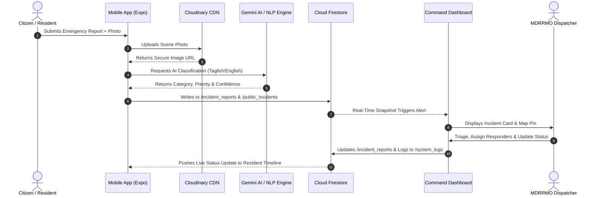
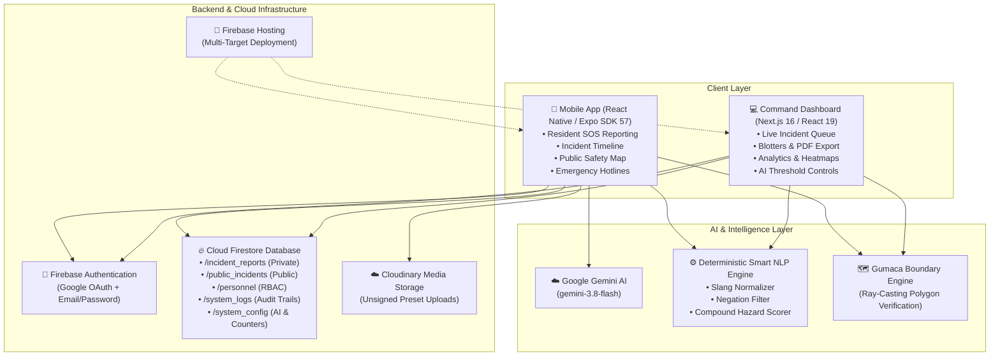
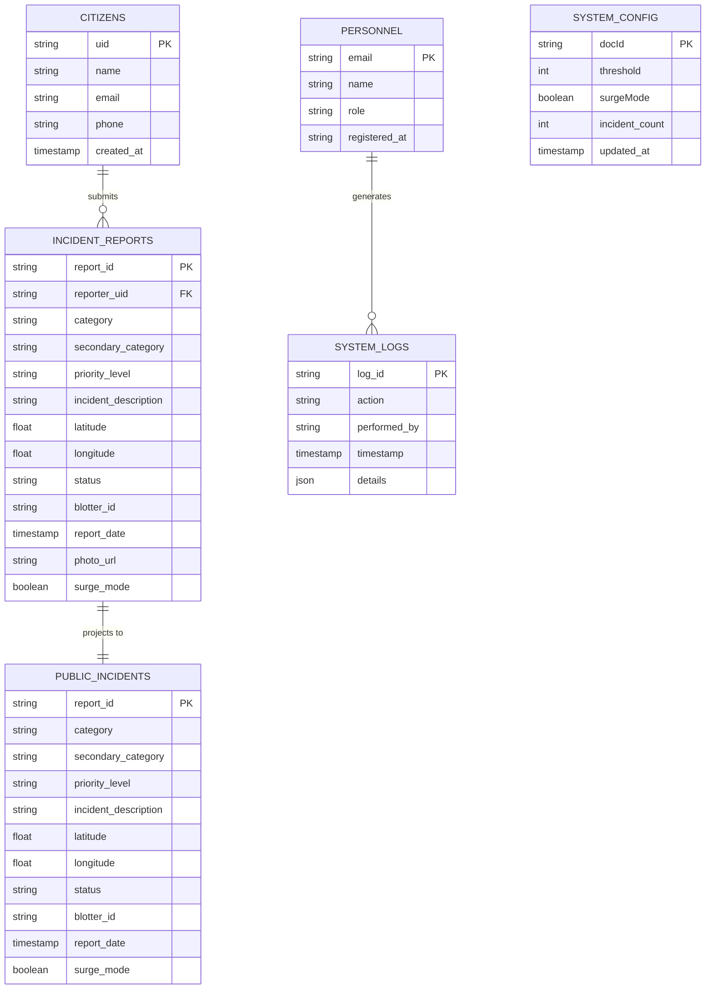

# 🛡️ KALASAG-AI

**Next-Generation Multi-Hazard Disaster Monitoring & Emergency Response System**  
*Specially engineered for the Municipal Disaster Risk Reduction and Management Office (MDRRMO) of Gumaca, Quezon.*

[](https://nextjs.org/)
[](https://react.dev/)
[](https://reactnative.dev/)
[](https://expo.dev/)
[](https://firebase.google.com/)
[](https://leafletjs.com/)
[](file:///c:/Users/cedri/Desktop/KalasagAi/kalasag-mobile/LICENSE)
[](file:///c:/Users/cedri/Desktop/KalasagAi/kalasag-dashboard/scripts/test_nlp.js)

---

## 📌 Overview

**KALASAG-AI** is a multi-hazard emergency dispatch, disaster monitoring, and incident response platform tailored for the **Municipality of Gumaca, Quezon**. The platform bridges local residents and MDRRMO emergency operations personnel through a synchronized ecosystem comprising a **Web Command & Dispatch Dashboard** (`kalasag-dashboard`) and a **Cross-Platform Resident Mobile App** (`kalasag-mobile`).

During disasters and emergencies, citizen reports are often submitted in mixed Tagalog, English, and local Taglish dialects under high stress. KALASAG-AI addresses this challenge by employing a **Dual-Layer Intelligent Triage Engine**:
1. **Primary Cloud Layer**: Google Gemini generative AI (`gemini-3.8-flash`) for contextual Taglish reasoning and multi-hazard assessment.
2. **Fail-Safe Local Layer**: An offline, deterministic rule-based NLP classifier featuring Taglish slang expansion, typo correction, word-boundary collision protection, negation/drill detection, Gumaca landmark recognition, and compound hazard scoring.

The platform ensures that life-threatening incidents are rapidly prioritized, mapped within official municipal boundaries (covering 59 barangays across 189.65 km²), matched to recommended response units (BFP, PNP, WASAR, MHO EMS, DPWH, PCG Auxiliary), and archived into official electronic blotters with sequential audit trails.

---

## ✨ Key Features

### 1. Dual-Layer Taglish NLP & AI Classification
* **Google Gemini AI Integration**: Analyzes incoming natural-language incident descriptions with `gemini-3.8-flash` to identify categories, priorities, and reasoning.
* **Smart Rule-Based NLP Engine (Offline Fallback)**: Automatically activates if the cloud API is unavailable or unconfigured:
  * **Taglish Slang Normalizer**: Expands SMS shortcuts and phonetic typos (e.g., `sunooog` → `sunog`, `d2` → `dito`, `aksdente` → `aksidente`, `bahaaaaa` → `baha`).
  * **Negation & Drill Filter**: Detects simulated drills (`fire drill`, `earthquake drill`) and false alarms (`walang sunog`, `hupa na ang baha`), downgrading severity and preventing unnecessary vehicle dispatches.
  * **Entity Extraction**: Automatically extracts 10+ Gumaca landmarks (e.g., Maharlika Highway, Diversion Road, Pipisik River, Lamon Bay/coastal waters, Cathedral, Public Market), vulnerable groups (infants, elderly, pregnant women, PWDs), and active casualty indicators.

### 2. Compound Hazard Detection & Multi-Agency Dispatch
* Identifies complex, co-occurring emergencies and generates coordinated dispatch recommendations:
  * **Drowning + Sea Stranding**: Dispatches MDRRMO Water Search & Rescue (WASAR), Municipal Health Office (MHO) EMS, and PCG Auxiliary.
  * **Fire + Road Obstruction**: Dispatches Bureau of Fire Protection (BFP) Gumaca and Municipal Engineering Road Clearing.
  * **Vehicular Collision + Trauma**: Dispatches MHO EMS Ambulance, Gumaca PNP Traffic Enforcement, and MDRRMO Quick Response.
  * **Flooding + Trapped Individuals**: Dispatches WASAR Boat Rescue and MHO EMS standby.
  * **Flooding + Landslide/Debris**: Dispatches WASAR, DPWH 4th District Engineering Office, and Municipal Engineering.

### 3. Geospatial Triage & Municipal Boundary Enforcement
* **189.65 km² Boundary Polygon**: Built-in GeoJSON polygon (`gumaca-boundary.json`) containing official boundary limits for all 59 barangays of Gumaca.
* **Ray-Casting Boundary Verification**: Verifies incident GPS coordinates against the official municipal perimeter to prevent out-of-jurisdiction dispatches.
* **Interactive Mapping**: Powered by Leaflet, `leaflet.heat` heatmaps, and `leaflet.markercluster` for density clustering and real-time spatial situational awareness.

### 4. Role-Based Operations Command Dashboard
* **Real-Time Incident Feed**: Subscribes to live Firestore incident updates with sound and visual badges.
* **Electronic Blotter System**: Automatically tracks sequential Blotter IDs (`BLT-YYYY-XXXXX`) and Report IDs (`REPORT 01`, `REPORT 02`).
* **Document Exports**: Generates official PDF incident blotters using `jspdf` and exports audit logs to CSV.
* **AI Controls & Surge Mode**: Allows administrators to adjust the AI confidence threshold (50%–95%) and toggle high-urgency Surge Mode system-wide.

### 5. Citizen Mobile Application
* **One-Tap Emergency Reporting**: Quick category selection (`flooding`, `fire incident`, `road obstruction`, `medical emergency`, `other disaster-related incidents`).
* **GPS Auto-Acquisition**: Uses `expo-location` for device geolocation with manual map coordinate adjustments.
* **Cloudinary Photo Evidence**: Uploads compressed scene photos to Cloudinary CDN via unsigned upload presets.
* **Incident Status Tracker**: Timeline tracking from *Pending* → *In Progress* → *Resolved* → *Closed*.
* **Emergency Hotlines**: Direct one-tap phone dialing via `expo-linking` for MDRRMO Gumaca (`09463333911`), PNP (`09988568352`), and BFP (`09178616285`).

---

## 🔄 How It Works



---

## 🏛️ System Architecture



---

## 👥 User Roles & Access Control

Role-Based Access Control (RBAC) is enforced across both the frontend ([`auth-context.js`](file:///c:/Users/cedri/Desktop/KalasagAi/kalasag-dashboard/src/lib/auth-context.js)) and database security rules ([`firestore.rules`](file:///c:/Users/cedri/Desktop/KalasagAi/firestore.rules)):

| Role | Target Interface | Permissions & Capabilities |
| :--- | :--- | :--- |
| **Citizen / Resident** | Mobile App | Submit incident reports with GPS & photos; view personal report history; view public safety map and hotlines. |
| **Responder** | Dashboard | View live Command Center incident queue, incident locations on map, read-only access to blotters and analytics. |
| **Communication Officer** | Dashboard | View Command Center, Blotters, Analytics, System Logs; update incident status (`In Progress`, `Resolved`, `Closed`); assign response units; export incident CSV & PDF reports. |
| **Admin** | Dashboard | All Communication Officer rights + access Admin Controls; manage staff personnel accounts (`Responder`, `Communication Officer`); adjust AI confidence threshold & Surge Mode; export system data backups. |
| **Super Admin** | Dashboard | Root privileged account; all Admin rights + exclusive authority to manage, promote, and demote `Admin` personnel. Role cannot be revoked via client SDK. |

---

## 🛠️ Technology Stack

| Category | Technology | Usage in Project |
| :--- | :--- | :--- |
| **Frontend Framework (Dashboard)** | Next.js 16.2.10 (App Router) | Web command dashboard architecture and routing |
| **UI Library (Dashboard)** | React 19.2.4 & Vanilla CSS | Dashboard state management, responsive dark/light layouts |
| **Mobile Framework** | React Native 0.86.0 / Expo SDK 57 | Cross-platform citizen mobile application |
| **Mobile Navigation** | Expo Router 57.0.7 | File-based navigation for tabs, login, and signup |
| **Programming Languages** | TypeScript & JavaScript (ES6+) | Typed mobile app, dynamic dashboard logic, and scripts |
| **Database** | Google Cloud Firestore 12.15.0 / 12.16.0 | Real-time synchronized NoSQL database |
| **Authentication** | Firebase Authentication | Google OAuth popup/credential & Email/Password authentication |
| **Cloud Storage** | Cloudinary CDN | Cloud media storage for incident photo/video evidence |
| **AI / Machine Learning** | Google Gemini 3.8 Flash | Generative Taglish incident assessment and triage |
| **Local NLP / Fallback** | Deterministic Regex & Scoring Engine | Slang normalization, entity extraction, and compound triage |
| **Mapping & Geospatial** | Leaflet 1.9.4 & OpenStreetMap | Geospatial visualization, polygon boundaries, and heatmaps |
| **Clustering & Heatmaps** | Leaflet.heat & Leaflet.markercluster | Incident density heatmaps and map marker aggregation |
| **Document Generation** | jsPDF 4.2.1 | Client-side generation of official MDRRMO incident blotter PDFs |
| **Data Visualization** | Chart.js 4.5.1 & react-chartjs-2 | Analytics charts for incident categories and hourly surge trends |
| **Device Capabilities** | `expo-location`, `expo-image-picker` | Native GPS acquisition and mobile camera/gallery access |
| **Hosting & Deployment** | Firebase Hosting | Production multi-target hosting for dashboard and mobile web |
| **Testing** | Node.js Test Harness (`test_nlp.js`) | Automated unit test suite verifying NLP classification |
| **Code Quality** | ESLint 9 & TypeScript Compiler | Linting and static analysis across dashboard and mobile |

---

## 📁 Project Structure

```text
KalasagAi/
├── .firebaserc                              # Firebase project alias (kalasagai-9dc73)
├── .gitignore                               # Root gitignore protecting keys, envs, and binaries
├── firebase.json                            # Multi-target hosting and Firestore deployment config
├── firestore.rules                          # Role-based Firestore security rules
├── README.md                                # Comprehensive repository documentation
│
├── kalasag-dashboard/                       # Next.js 16 Web Command Dashboard
│   ├── public/                              # Static web assets and icons
│   │   └── downloads/                       # APK distribution notes and placeholder
│   ├── scripts/                             # Utility and test scripts
│   │   └── test_nlp.js                      # 8-scenario NLP test suite
│   ├── src/
│   │   ├── app/                             # Next.js App Router routes
│   │   │   ├── dashboard/                   # Protected dashboard views
│   │   │   │   ├── admin/page.js            # Personnel and system administration
│   │   │   │   ├── ai-volume/page.js        # AI triage controls and threshold sliders
│   │   │   │   ├── analytics/page.js        # Charts and statistical summaries
│   │   │   │   ├── blotters/page.js         # Incident records and PDF export
│   │   │   │   ├── layout.js                # Authenticated layout and sidebar navigation
│   │   │   │   └── page.js                  # Primary Command Center & Live Map
│   │   │   ├── login/page.js                # Personnel login and mobile download portal
│   │   │   ├── globals.css                  # Unified CSS design system
│   │   │   └── layout.js                    # Root layout with theme provider
│   │   ├── components/                      # UI components (Icons, Map, Toast, Theme)
│   │   ├── data/                            # GIS and boundary data
│   │   │   └── gumaca-boundary.json         # 189.65 km² polygon GeoJSON
│   │   └── lib/                             # Core dashboard libraries
│   │       ├── ai-config.js                 # Firestore AI control settings sync
│   │       ├── auth-context.js              # RBAC permission matrix
│   │       ├── boundary-helper.js           # Ray-casting polygon intersection algorithm
│   │       ├── classifier.js                # Dashboard Taglish NLP engine
│   │       ├── firebase.js                  # Firebase app and auth initialization
│   │       ├── id-helper.js                 # Sequential report and blotter ID formatter
│   │       ├── logs.js                      # System audit logger
│   │       ├── pdf-export.js                # jsPDF official blotter generation
│   │       └── public-incidents.js          # Projection synchronizer
│   ├── .env.example                         # Dashboard environment variable template
│   └── package.json                         # Dashboard dependencies and scripts
│
└── kalasag-mobile/                          # React Native / Expo Resident Application
    ├── assets/                              # App icons, splash screens, and badges
    ├── src/
    │   ├── app/                             # Expo Router file-based screens
    │   │   ├── (tabs)/                      # Tab navigation screens
    │   │   │   ├── explore.tsx              # Disaster guidelines and emergency hotlines
    │   │   │   ├── index.tsx                # Emergency report form with live AI preview
    │   │   │   ├── map.tsx                  # Public safety incident map
    │   │   │   ├── reports.tsx              # Personal incident history tracker
    │   │   │   └── _layout.tsx              # Bottom tab bar configuration
    │   │   ├── login.tsx                    # Citizen login screen
    │   │   ├── signup.tsx                   # Citizen registration screen
    │   │   └── _layout.tsx                  # Root navigation stack
    │   ├── components/                      # Mobile UI elements and native map preview
    │   ├── constants/                       # Static configurations
    │   │   ├── hotlines.ts                  # Gumaca emergency telephone numbers
    │   │   └── theme.ts                     # Color tokens and design constants
    │   ├── data/
    │   │   └── gumaca-boundary.json         # Municipal GeoJSON boundary copy
    │   └── lib/                             # Mobile utilities and API clients
    │       ├── ai-config.ts                 # AI threshold subscriber
    │       ├── auth-context.tsx             # Citizen session context
    │       ├── boundary-helper.ts           # Mobile boundary validator
    │       ├── cloudinary.ts                # Unsigned media uploader
    │       ├── firebase.ts                  # Mobile Firebase initialization
    │       ├── gemini.ts                    # Gemini AI client and Smart NLP classifier
    │       └── report-ids.ts                # Mobile report ID derivation
    ├── .env.example                         # Mobile environment variable template
    ├── app.json                             # Expo application manifest
    ├── eas.json                             # EAS build profiles for Android APK
    ├── LICENSE                              # MIT License
    └── package.json                         # Mobile dependencies and scripts
```

---

## 🖥️ Screens & Interfaces

### Command Dashboard (`kalasag-dashboard`)
* **`/login`**: Secure portal for personnel with Google Sign-in, credentials login, and citizen mobile download options (GitHub Release & Google Drive mirror).
* **`/dashboard`**: Real-time Command Center featuring live Leaflet map with incident markers, triage badges, active emergency queue, and dispatch assignment drawer.
* **`/dashboard/blotters`**: Official e-blotter table with search, category filtering, sequential `BLT-YYYY-XXXXX` codes, and one-click PDF generation.
* **`/dashboard/analytics`**: Visual charts displaying category distribution, hourly report volume, priority ratios, and response metrics.
* **`/dashboard/ai-volume`**: Operational control room to adjust AI triage thresholds and toggle system-wide Surge Mode during extreme weather.
* **`/dashboard/admin`**: Personnel roster management for adding responders, reassigning roles, inspecting system health, and downloading audit backups.

### Resident Mobile App (`kalasag-mobile`)
* **`Report Screen` (`(tabs)/index.tsx`)**: Citizen incident report form with live Taglish smart classifier feedback, photo picker, and automatic GPS coordinate tagging.
* **`Incident Map` (`(tabs)/map.tsx`)**: Public interactive map displaying verified incidents, municipal borders, and safety zones.
* **`My Reports` (`(tabs)/reports.tsx`)**: Personal dashboard tracking submitted reports with visual status timeline steps.
* **`Hotlines & Guidelines` (`(tabs)/explore.tsx`)**: Directory of emergency hotlines with one-tap dialing and disaster safety guides for typhoons, floods, earthquakes, and fires.
* **`Auth Screens` (`login.tsx`, `signup.tsx`)**: Citizen onboarding with email validation, password reset, and account security.

---

## 🚀 Setup & Installation

### Prerequisites
* **Node.js**: v18.x, v20.x, or v24.x
* **npm**: v9+ or **yarn**
* **Expo Go**: Installed on an Android or iOS device (or an Android Emulator / iOS Simulator)
* **Firebase Project**: A Firebase project with Cloud Firestore and Authentication enabled

---

### 1. Dashboard Setup (`kalasag-dashboard`)

```bash
# Navigate to the dashboard directory
cd kalasag-dashboard

# Install dependencies
npm install

# Configure environment variables
cp .env.example .env.local

# Run the local development server
npm run dev
```

Open [http://localhost:3000](http://localhost:3000) in your web browser.

To verify code quality or build the static production bundle:
```bash
# Run linting
npm run lint

# Build static production bundle (outputs to kalasag-dashboard/out)
npm run build
```

---

### 2. Resident Mobile App Setup (`kalasag-mobile`)

```bash
# Navigate to the mobile directory
cd kalasag-mobile

# Install dependencies
npm install

# Configure environment variables
cp .env.example .env

# Start the Expo development server
npx expo start
```

* **On Android**: Press `a` in the terminal to launch in an Android Emulator, or scan the terminal QR code with the **Expo Go** app.
* **On Web**: Press `w` to run in a web browser.
* **Run Linting**:
  ```bash
  npx expo lint
  ```

---

## 🔐 Environment Variables & Configuration

### Dashboard: `kalasag-dashboard/.env.local`
*(Use [`kalasag-dashboard/.env.example`](file:///c:/Users/cedri/Desktop/KalasagAi/kalasag-dashboard/.env.example) as template)*

```env
# Firebase Web App Credentials (from Firebase Console -> Project Settings)
NEXT_PUBLIC_FIREBASE_API_KEY=your_firebase_api_key_here
NEXT_PUBLIC_FIREBASE_AUTH_DOMAIN=your_project_id.firebaseapp.com
NEXT_PUBLIC_FIREBASE_PROJECT_ID=your_project_id
NEXT_PUBLIC_FIREBASE_STORAGE_BUCKET=your_project_id.firebasestorage.app
NEXT_PUBLIC_FIREBASE_MESSAGING_SENDER_ID=your_messaging_sender_id
NEXT_PUBLIC_FIREBASE_APP_ID=your_firebase_app_id
NEXT_PUBLIC_FIREBASE_MEASUREMENT_ID=your_measurement_id

# Google Gemini AI API Key (from Google AI Studio)
GEMINI_API_KEY=your_gemini_api_key_here
```

### Mobile App: `kalasag-mobile/.env`
*(Use [`kalasag-mobile/.env.example`](file:///c:/Users/cedri/Desktop/KalasagAi/kalasag-mobile/.env.example) as template)*

```env
# Firebase Credentials (from Firebase Console -> Project Settings)
EXPO_PUBLIC_FIREBASE_API_KEY=your_firebase_api_key_here
EXPO_PUBLIC_FIREBASE_AUTH_DOMAIN=your_project_id.firebaseapp.com
EXPO_PUBLIC_FIREBASE_PROJECT_ID=your_project_id
EXPO_PUBLIC_FIREBASE_STORAGE_BUCKET=your_project_id.firebasestorage.app
EXPO_PUBLIC_FIREBASE_MESSAGING_SENDER_ID=your_messaging_sender_id
EXPO_PUBLIC_FIREBASE_APP_ID=your_firebase_app_id
EXPO_PUBLIC_FIREBASE_MEASUREMENT_ID=your_measurement_id

# Google Gemini AI API Key
EXPO_PUBLIC_GEMINI_API_KEY=your_gemini_api_key_here

# Cloudinary Storage Configuration (for photo/video evidence)
EXPO_PUBLIC_CLOUDINARY_CLOUD_NAME=your_cloudinary_cloud_name
EXPO_PUBLIC_CLOUDINARY_UPLOAD_PRESET=your_cloudinary_upload_preset
```

---

## 🗄️ Database Architecture & Collections

The system operates on **Google Cloud Firestore** governed by strict security rules ([`firestore.rules`](file:///c:/Users/cedri/Desktop/KalasagAi/firestore.rules)):



* **`incident_reports`**: Master records. Readable only by assigned personnel or the original submitting citizen (`reporter_uid == auth.uid`).
* **`public_incidents`**: Sanitized projection containing category, priority, coordinates, and status without personal citizen identity data. Publicly readable to power real-time community safety maps.
* **`personnel`**: Staff registry keyed by email, establishing RBAC permissions.
* **`citizens`**: User profile documents created upon mobile registration.
* **`system_logs`**: Immutable audit logs of dispatches, status changes, and data exports.
* **`system_config`**: Contains singleton documents `ai_controls` (threshold & surgeMode) and `report_counter` (atomic sequence increment).

---

## 🔒 Security & Privacy

1. **Database-Level Firewall**: Enforced by [`firestore.rules`](file:///c:/Users/cedri/Desktop/KalasagAi/firestore.rules). Write requests are validated against coordinate boundaries, data schemas, role assignments, and email identity matching.
2. **Credential Safety**: All API keys, Firebase service accounts, and keystores are excluded from Git via root and submodule `.gitignore` files.
3. **Restricted Client Media Uploads**: Mobile uploads use unsigned, scoped Cloudinary presets limited to image formats and constrained folders, avoiding exposure of private API secrets on client devices.
4. **Super Admin Guard**: Database security rules enforce that accounts with the `Super Admin` role cannot be deleted or demoted through client-side API manipulation.

---

## 🧪 Testing & Verification

An automated regression test suite is included in [`kalasag-dashboard/scripts/test_nlp.js`](file:///c:/Users/cedri/Desktop/KalasagAi/kalasag-dashboard/scripts/test_nlp.js) to validate the Taglish NLP classifier across complex real-world emergency scenarios:

```bash
# Run the NLP test harness
node kalasag-dashboard/scripts/test_nlp.js
```

### Verified Test Suite Results (8/8 Passing):
* `Test #1`: Drowning casualty + maritime stranding (`"May nalulunod na tao at mga stranded na tao sa dagat"`) → **Medical Emergency + Flooding (Compound) [High]**
* `Test #2`: Taglish slang with typos near landmark (`"sunooog po d2 s gawing simbahan may mga nakaharang n debris"`) → **Fire Incident + Road Obstruction (Compound) [High]**
* `Test #3`: Vehicular collision with injuries on highway (`"Salpukan ng bus at tricycle sa Maharlika Highway"`) → **Medical Emergency + Road Obstruction (Compound) [High]**
* `Test #4`: River overflow with trapped children (`"Umapaw ang ilog sa Pipisik lagpas tao ang baha may mga bata na na-trap"`) → **Flooding + Medical Emergency (Compound) [High]**
* `Test #5`: Mountain landslide blocking road (`"Naguho ang bundok sa diversion road natabunan ng lupa"`) → **Road Obstruction [High]**
* `Test #6`: Cardiac emergency at barangay hall (`"Matandang inatake sa puso sa barangay hall"`) → **Medical Emergency [High]**
* `Test #7`: Negation / False Alarm (`"Walang sunog dito mali lang ang akala naapula agad"`) → **Other Disaster [Low]**
* `Test #8`: Simulated Drill (`"Fire drill lang po ito ng eskwelahan sa Gumaca West"`) → **Other Disaster [Low]**

---

## 📦 Deployment & APK Distribution

The repository is configured for dual-target **Firebase Hosting** ([`firebase.json`](file:///c:/Users/cedri/Desktop/KalasagAi/firebase.json)):

```bash
# Build dashboard production bundle
cd kalasag-dashboard && npm run build && cd ..

# Export mobile web bundle
cd kalasag-mobile && npx expo export -p web && cd ..

# Deploy both web targets and Firestore security rules
firebase deploy --only hosting,firestore:rules
```

### Android APK Distribution:
Due to GitHub's 100 MB per-file repository limit, the compiled `kalasag-resident.apk` (109 MiB) is hosted externally and linked on the dashboard login page:
1. **GitHub Releases (Recommended)**: Tag `v1.0.3` is available on GitHub for downloading release assets.
2. **Google Drive Mirror**: Direct download link integrated into [`kalasag-dashboard/src/app/login/page.js`](file:///c:/Users/cedri/Desktop/KalasagAi/kalasag-dashboard/src/app/login/page.js) as a backup mirror.

---

## 📊 Feature Status

| Module / Feature | Implementation Status | Notes |
| :--- | :---: | :--- |
| **Dual-Layer Taglish NLP Engine** | ✅ Implemented | Complete with slang map, entity extraction, and compound scorer |
| **Google Gemini AI Integration** | ✅ Implemented | Connects to `gemini-3.8-flash` with graceful local fallback |
| **Gumaca Geographic Boundary Check** | ✅ Implemented | Ray-casting polygon intersection using official GeoJSON |
| **Command Center Live Map & Triage** | ✅ Implemented | Leaflet map with priority clustering, status filters, and dispatch |
| **Electronic Blotters & PDF Export** | ✅ Implemented | Sequential blotter numbering with jsPDF document rendering |
| **Operational Analytics & Charts** | ✅ Implemented | Real-time Chart.js visual statistics |
| **Admin Controls & Personnel RBAC** | ✅ Implemented | Role management, threshold slider, and audit logs |
| **Resident Mobile App (SOS & GPS)** | ✅ Implemented | One-tap incident reporting, image capture, and status tracking |
| **Cloudinary Media Storage** | ✅ Implemented | Unsigned image uploads with secure CDN delivery |
| **Emergency Hotlines Directory** | ✅ Implemented | Quick-dialing for Gumaca MDRRMO, BFP, PNP, and Health Office |
| **SMS Gateway Fallback (Offline GSM)** | 🔮 Planned | Integration with hardware GSM modem or SMS API for zero-data reporting |
| **Push Notifications (FCM / APNs)** | 🔮 Planned | Device push alerts when incident statuses transition |

---

## ⚠️ Limitations

1. **Geographic Focus**: The boundary verification algorithms and entity extraction dictionaries are currently calibrated specifically for the 59 barangays and landmarks of **Gumaca, Quezon**.
2. **Connectivity Requirement**: Submitting reports and streaming real-time dashboard updates requires an active internet connection. (Offline fallback handles classification logic, but Firestore synchronization requires connectivity).
3. **APK File Size**: The standalone Android APK is ~109 MiB (packaged with native Expo runtimes and libraries), requiring external distribution via GitHub Releases or CDN rather than direct Git tracking.

---

## 💡 Potential Future Enhancements

* **Offline SMS / Telco Bridge**: Implement an SMS intake webhook allowing citizens without mobile data to submit reports via standard SMS shortcodes.
* **Push Notifications**: Integrate Firebase Cloud Messaging (FCM) or Expo Push Notifications to notify residents when responders are en route.
* **Drone / CCTV Stream Feeds**: Embed live RTMP/HLS feeds from municipal monitoring cameras in coastal barangays directly on the Command Center map.
* **Multi-Language Speech-to-Text**: Allow residents to record voice notes in Tagalog or Bikol-influenced dialects for automated transcription and triage.

---

## 🎯 Why This Project Matters

Provincial and coastal municipalities in the Philippines face recurrent typhoons, coastal storm surges, and logistical challenges during disaster events. By coupling localized natural language processing (understanding everyday Taglish text and slang) with instant spatial verification and multi-agency coordination, KALASAG-AI reduces triage delays from minutes to seconds—helping emergency dispatchers direct rescue boats, ambulances, and fire trucks to the right citizens when every second counts.

---

## ❓ Frequently Asked Questions (FAQ)

**Q: Can the mobile app work if there is no Gemini API key configured?**  
A: Yes. The mobile app automatically detects if `EXPO_PUBLIC_GEMINI_API_KEY` is missing or unreachable and falls back seamlessly to the built-in deterministic Smart NLP engine without interrupting the user.

**Q: Why are `.env` files not in the repository?**  
A: `.env` and `.env.local` files contain secret API keys and credentials. They are strictly ignored by Git to protect project security. Use `.env.example` templates to set up your local environment.

**Q: What happens if an incident is reported outside Gumaca?**  
A: The ray-casting algorithm detects if coordinates fall outside the 189.65 km² polygon. The dashboard flags these reports as out-of-jurisdiction for dispatcher review.

---

## ⚖️ Disclaimer

*KALASAG-AI is an emergency monitoring and decision-support system designed to assist local government emergency management personnel. It does not replace direct voice communication with emergency services during immediate life-or-death situations. Always dial 911 or the official MDRRMO Gumaca hotline (09463333911) during active emergencies.*

---

## 📄 License

This project is licensed under the **MIT License** - see the [`kalasag-mobile/LICENSE`](file:///c:/Users/cedri/Desktop/KalasagAi/kalasag-mobile/LICENSE) file for details.

---

## 🤝 Credits & Acknowledgements

* **Municipal Disaster Risk Reduction and Management Office (MDRRMO)** — Gumaca, Quezon, Philippines.
* **Municipality of Gumaca** — Official emergency hotlines and administrative GIS data.
* **Technological Institute of the Philippines (TIP)** — Institutional research and engineering development.
