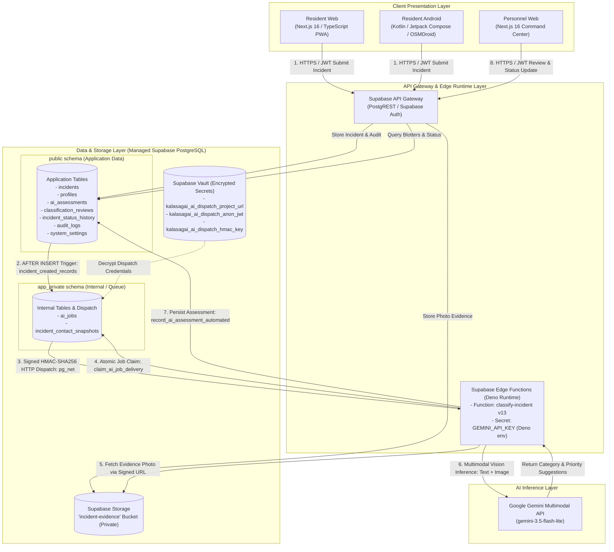
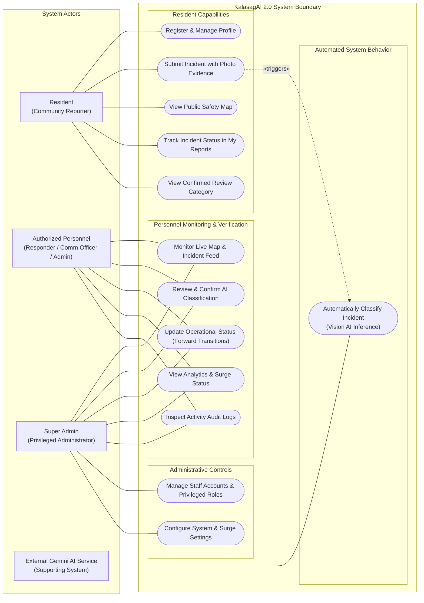
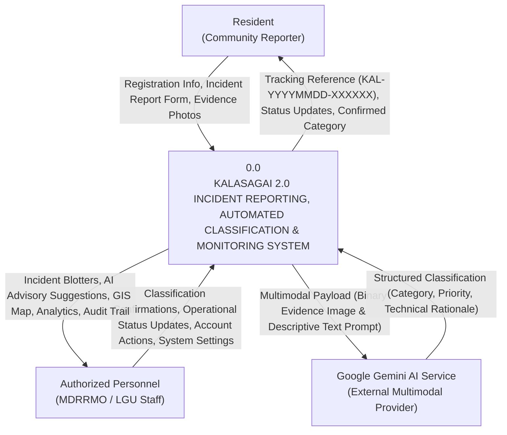
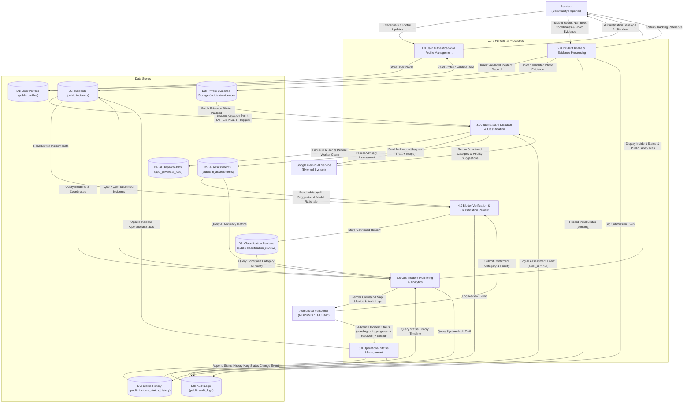
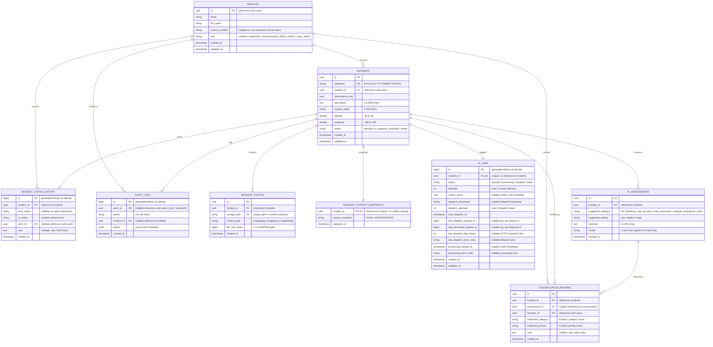
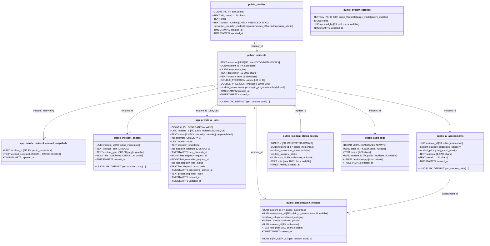
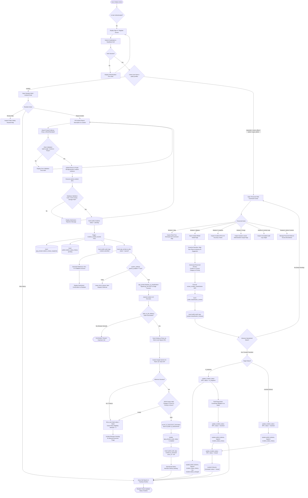
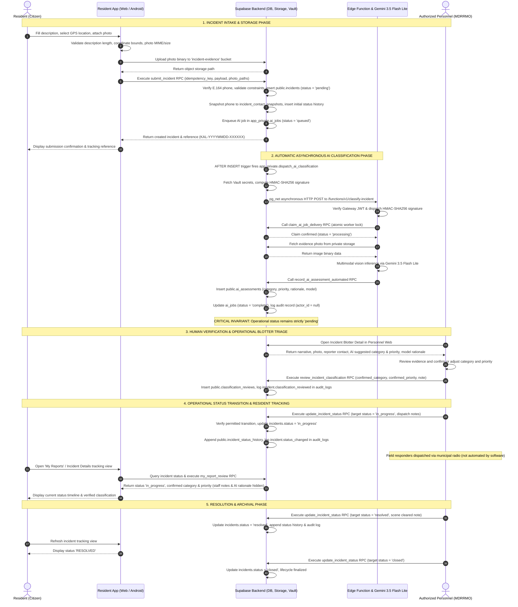

# KalasagAI 2.0 — Final System Scope & Technical Alignment Specification

## Current web features

**Capstone release `1395b08`, documented November 25, 2026.** The following seven modules group the features for a panel walkthrough. Personnel Web has five role-filtered navigation links. Surge monitoring and AI controls are inside **Admin Controls**.

| Module | What a resident, operator, or administrator can do |
| --- | --- |
| Resident reporting and tracking | Register, confirm an email address, sign in, recover access, and edit a profile. Choose an English/Tagalog prompt for flooding, fire, medical emergency, road accident, road obstruction, or another hazard. Enter a description and landmark, use GPS or drag a pin, and attach a photo from the camera, gallery, clipboard, or drag-and-drop. Preview JPG, PNG, or WebP evidence up to 10 MB. Retry an interrupted submission using its original report key. The receipt shows the reference and that category and priority await personnel review. Search or filter **My Reports** and open the evidence, reviewed classification, and status history. |
| Incident mapping and alerts | Select a report from a map or list, inspect clustered markers, and recenter the map. The personnel map includes the Gumaca boundary and map key. While Personnel Web is open, new reports can trigger a banner and sound across dashboard pages. Staff can mute or enable sound, open the report from the alert, and dismiss it. The app suppresses duplicate notifications and checks for missed reports on return. |
| Personnel case management | Search, filter, sort, and page through the incident register. Open a quick view or the full record, inspect coordinates, enlarge private evidence, and copy the reporter contact when authorized. Add a note when advancing an incident from pending to in progress, resolved, or closed. Residents can follow the recorded changes. |
| AI-assisted classification and human review | When enabled, Gemini uses the description and evidence to suggest a category and a low, medium, or high priority. Authorized personnel can inspect the rationale and confirm or correct the category and priority. A staff review records a separate decision. Operational status changes require a personnel action. |
| Analytics and exports | Filter charts by 24 hours, 7 days, 30 days, or all time. Select a chart segment to see matching reports. Review resolution rate and the percentage of reviewed reports where the AI category matched the staff decision. Download PDFs for an individual incident, a filtered register, an analytics summary, or an authorized activity-log view. |
| Staff administration and surge monitoring | Invite staff by email, send password-reset links, and manage roles. Admins can invite responders and communication officers. Super Admins can also invite Admins and Super Admins. Inspect report volume, set the surge reference threshold, toggle surge monitoring, and manage automatic AI classification. |
| Access control and audit history | Residents see their own records. Personnel access depends on the Responder, Communication Officer, Admin, or Super Admin role. Private evidence uses time-limited links. Authorized administrators can search the activity log for report events, status changes, actors, and system changes. |

Both web apps remember the selected light or dark theme. Personnel Web also offers a collapsible sidebar and keyboard dismissal of expanded evidence. For test methods and remaining live checks, see the [web release report](KALASAGAI_WEB_RELEASE_REPORT.md).

## Earlier scope baseline

**Client:** KALASAG, Barangay Poblacion, Municipality of Gumaca, Quezon, Philippines  
**System Title:** KalasagAI 2.0 — AI-Powered Incident Reporting, Classification, and Monitoring System  
**Document Classification:** Capstone Technical Specification & System Scope Baseline  
**Date of Alignment:** 2026-11-23  
**Status:** Approved Final Scope (Emergency Hotlines Removed from Resident Applications)  

> **Historical scope note — 2026-11-24:** This specification records the earlier multi-client baseline. The project owner has since removed the native Resident Android project and its active distribution/build integrations; Resident Web is the current resident client. Android implementation and test references below are historical. The current Personnel Web sidebar has five role-filtered links, with AI Volume & Surge controls nested under Admin Controls; the six-module diagram below is historical.

---

## 1. Executive Summary & Scope Baseline

KalasagAI 2.0 is an automated emergency reporting, artificial intelligence classification, and incident monitoring platform designed specifically for the community of Barangay Poblacion, Gumaca, Quezon. 

Following formal evaluation, the **Emergency Hotlines feature has been permanently and completely removed from all resident-facing client applications** (both Resident Web and Native Resident Android). The platform focuses its resident experience exclusively on:
1. Secure account registration and profile management with verified contact details.
2. Fast, resilient digital incident intake with GPS coordinates and mandatory private evidence photos.
3. Interactive public safety maps showing real-time community hazards.
4. Transparent incident status tracking allowing residents to follow submitted reports from receipt through resolution.

Every submitted incident is automatically processed through the backend by **Google Gemini Multimodal Vision AI (`gemini-3.5-flash-lite`)** to suggest one of six operational categories and an initial priority level. Crucially, **AI suggestions never alter operational status, do not dispatch emergency responders, and remain subject to mandatory human verification** by authorized personnel.

---

## 2. Approved Final System Scope

### A. Approved Resident-Facing Feature Scope (10 Core Capabilities)
1. **Resident Authentication & Profile Management:** Email and password login, secure password reset, profile editing (full name, Philippine contact number).
2. **Resident Dashboard & Home:** Live emergency status summary, immediate access to reporting actions, and high-level hazard alerts.
3. **Emergency Incident Reporting:** Structured digital incident submission with Tagalog/Taglish/English input and preset incident shortcuts.
4. **Geographic Incident Location:** Automated device GPS acquisition or manual pin adjustment constrained to Gumaca coordinates.
5. **Private Photo Evidence Upload:** Secure client-side image attachment with MIME-type restriction and client-side payload validation.
6. **Public Safety Map & Category Filtering:** Interactive OpenStreetMap canvas visualizing active community incidents with category chips (Flooding, Fire, Road Accident, Road Obstruction, Medical Emergency, Other).
7. **My Reports History:** Chronological personal report log with operational status badges.
8. **Incident Details View:** Comprehensive single-incident inspection displaying reference number, timestamp, location, coordinates, and photo evidence.
9. **Operational Status Tracking:** Real-time visibility into the official administrative status. The four values in the `incident_status` enum are: `pending`, `in_progress`, `resolved`, and `closed`. Note: `under_review` and `rejected` are not implemented.
10. **Personnel-Confirmed Classification Information:** Display of confirmed category and priority after human review, while keeping internal staff notes and raw AI prompts completely confidential.

### B. Prohibited / Removed Resident Features
- **NO Emergency Hotlines Screen:** Completely deleted.
- **NO Emergency Phone Directories:** No static contact cards or dialing lists.
- **NO Dedicated "Call" Action Buttons:** No telephony intents in resident clients.
- **NO Unauthenticated Public Incident Intake:** All reports require authenticated resident credentials.

### C. Personnel Web — Six Official Operational Modules
Personnel Web preserves exactly six official modules with zero removals, renames, or functional mergers:
1. **Module 1: Maps and Reports** (`/dashboard`) — Full GIS map of Gumaca with interactive incident pins, category/status filters, and lifecycle transitions.
2. **Module 2: Incident Blotters** (`/dashboard/blotters`, `/dashboard/blotters/[id]`) — Official blotter records, detailed inspection of AI classification suggestions, multimodal rationales, reporter contact numbers, and human verification forms.
3. **Module 3: Analytics & Reports** (`/dashboard/analytics`) — Incident volume metrics, historical trends, AI accuracy metrics, and export capabilities.
4. **Module 4: AI Volume & Surge** (`/dashboard/surge`) — System volume monitoring, capacity advisory indicators based on configurable surge threshold (`surge_threshold`) and administrative surge mode toggle (`surge_mode`). Surge settings are administrative controls and visual advisory indicators; there are no automated intake cutoffs or autonomous throttling triggers in the database.
5. **Module 5: Activity Logs** (`/dashboard/activity`) — Audit trail viewer displaying events stored in `public.audit_logs`, recording system and personnel actions. (The synthetic classification test records 3 events: `incident.submitted`, `incident.ai_assessed`, and `incident.classification_reviewed`; a full lifecycle through resolution adds `incident.status_changed` for 4 primary events). Note: `audit_logs` is a standard PostgreSQL table with RLS, not a cryptographically signed ledger.
6. **Module 6: Admin Controls** (`/dashboard/admin`) — Role-based access control directory, personnel invitations, and administrative privilege management.

---

## 3. Client Navigation Specifications

```
+--------------------------------------------------------------------------------------------------+
|                                  CLIENT NAVIGATION STRUCTURE                                     |
+-----------------------------------+----------------------------------+---------------------------+
| Resident Web (Mobile PWA)         | Resident Android (Compose App)   | Personnel Web (Dashboard) |
+-----------------------------------+----------------------------------+---------------------------+
| 1. Report       (/report)         | 1. Home        (Dashboard)       | 1. Maps & Reports         |
| 2. Map          (/dashboard)      | 2. Map         (Hazard View)     | 2. Blotters Directory     |
| 3. My Reports   (/reports)        | 3. My reports  (History View)    | 3. Analytics & Reports    |
| 4. Profile      (/profile)        | 4. Profile     (Account View)    | 4. AI Volume & Surge      |
|                                   | FAB: Report Incident Action      | 5. Activity Logs          |
|                                   |                                  | 6. Admin Controls         |
+-----------------------------------+----------------------------------+---------------------------+
```

---

## 4. Automatic Gemini AI Classification Architecture

The AI subsystem operates asynchronously and server-side:

```
[Resident Submits Report]
          │
          ▼
[submit_incident RPC] ──────► [Atomic DB INSERT in public.incidents]
                                        │
                                        ▼ (AFTER INSERT Trigger)
                              [app_private.record_incident_creation]
                                        │
                                        ▼
                              [Enqueued in app_private.ai_jobs]
                                        │
                                        ▼
                              [pg_net Asynchronous Dispatch]
                                        │ (Signed with Supabase JWT & Vault HMAC-SHA256)
                                        ▼
                              [classify-incident Edge Function v13]
                                        │
                                        ├─► [Validate Gateway JWT (verify_jwt=true)]
                                        ├─► [Validate HMAC-SHA256 Signature]
                                        ├─► [Atomic Job Claim (FOR UPDATE SKIP LOCKED)]
                                        ├─► [Download Private Evidence from Storage]
                                        ├─► [Multimodal Vision Call to Gemini 3.5 Flash Lite]
                                        │
                                        ▼
                              [Structured Suggestion Returned]
                                - Category: fire | flooding | road_accident |
                                            road_obstruction | medical_emergency | other
                                - Priority: low | medium | high
                                - Rationale: Multi-sentence vision rationale
                                        │
                                        ▼
                              [Persist to public.ai_assessments]
                                        │
                                        ▼
                              [Audit Trail Logged in public.audit_logs]
                                (actor_id = null -> Automated System Action)
```

### Critical Operational Invariants
- **Operational Status Isolation:** An AI assessment has **zero permission** to change an incident's operational status (`pending`). It remains strictly `pending` until human personnel act.
- **No Responder Dispatch:** AI suggestions do **not** dispatch responders or alert field units.
- **Mandatory Personnel Review:** AI outputs are advisory suggestions. Personnel review and confirm or correct both category and priority before closing or escalating.
- **Fail-Safe Operation:** If Gemini is unreachable or exhausts retries, the incident remains pending in the personnel queue for manual classification without data loss.

---

## 5. Technical System Diagrams (Capstone Evaluation Ready)

### Diagram 1: System Architecture Diagram



---

### Diagram 2: System Use Case Diagram



> *Academic Notation Note:* Standard UML 2.5 specifies actors as stick figures and associations as solid undirected lines. Because Mermaid's `flowchart` does not provide native UML actor symbols or generalization arrows (`--|>`), this diagram uses clean boundary subgraphs and undirected association links (`---`). The automated classification use case (`UC6`) is a backend system event triggered by incident submission (`UC2`) and supported by the external Gemini AI service. There is no separate `dispatcher` actor; dispatch is an operational status update performed by authorized personnel.

---

### Diagram 3: Data Flow Diagram — Level 0 (Context Diagram)



> *Academic Notation Note:* In formal DFD Level 0 (Context Diagram) rules, exactly one central system process (`0.0`) represents the entire system boundary. It is represented as a rectangular process box, not a database cylinder. No internal data stores or decision symbols appear in a context diagram. All incoming and outgoing data flows are balanced with the Level 1 DFD.

---

### Diagram 4: Data Flow Diagram — Level 1



> *Academic Notation Note:* Strict DFD Level 1 rules require all data moving into a data store to pass through a numbered application process. Evidence photos submitted by residents pass through Process `2.0` before reaching Store `D3`; no external entity communicates directly with a data store. No data store communicates directly with another data store. Process `3.0` (Automated AI Dispatch) is functionally distinct from Process `5.0` (Personnel Operational Status Management).

---

### Diagram 5: Entity-Relationship Diagram (ERD)



> *Academic Notation Note:* In relational schema modeling, 1:1 relationships exist only where explicitly enforced by unique constraints or primary key references. `INCIDENTS` to `INCIDENT_CONTACT_SNAPSHOTS` is strict 1:1 (`incident_id` is both PK and FK). `INCIDENTS` to `AI_JOBS` is strict 1:1 (`incident_id` has a UNIQUE constraint). Relationships between `INCIDENTS` and `AI_ASSESSMENTS` or `CLASSIFICATION_REVIEWS` are 1:N in schema definition (an incident may have subsequent assessments upon re-dispatch or multiple personnel review iterations over time), though normal operation yields one active assessment.

---

### Diagram 6: Database Schema Diagram (Physical Design)



---

### Diagram 7: Overall System Flowchart



---

### Diagram 8: AI Classification Process Flowchart

```mermaid
flowchart TD
    StartAI([Incident Inserted in public.incidents]) --> Trigger[AFTER INSERT Trigger: incident_created_records]
    Trigger --> CheckEnabled{Check system_settings:<br/>gemini_enabled == true?}
    
    CheckEnabled -- False --> DeferJob[Update app_private.ai_jobs:<br/>next_dispatch_at = now + 5 min<br/>last_dispatch_error_code = 'classification_disabled']
    DeferJob --> ManualQueue([Hold Incident in Queue: Manual Classification Required])

    CheckEnabled -- True --> Enqueue[Insert row into app_private.ai_jobs:<br/>status = 'queued', attempts = 0, dispatch_attempts = 0]
    
    %% Immediate Direct Database Dispatch
    Enqueue --> DirectDispatch[Execute app_private.dispatch_ai_classification: Immediate Dispatch]
    DirectDispatch --> ReadVault[Retrieve Secrets from Supabase Vault:<br/>- kalasagai_ai_dispatch_project_url<br/>- kalasagai_ai_dispatch_anon_jwt<br/>- kalasagai_ai_dispatch_hmac_key]
    
    ReadVault --> ConfigCheck{Vault Secrets Configured<br/>& Key Length >= 32 Bytes?}
    ConfigCheck -- No --> MissingConfig[Update ai_jobs: error = 'missing_dispatch_configuration'<br/>next_dispatch_at = now + 5 min]
    MissingConfig --> ManualQueue

    ConfigCheck -- Yes --> GenHMAC[Compute HMAC-SHA256 Token:<br/>message = timestamp . incident_id<br/>signature = hex encode HMAC-SHA256]
    GenHMAC --> PGNetPost[Dispatch Asynchronous HTTP POST via pg_net:<br/>Target = /functions/v1/classify-incident<br/>Headers = apikey, Authorization Bearer, x-kalasag-dispatch-*]

    %% Edge Function Execution
    PGNetPost --> EdgeGateway[Supabase API Gateway Receives Request]
    EdgeGateway --> GatewayJWT{verify_jwt Gateway Enforcement:<br/>Valid Supabase Token?}
    GatewayJWT -- No --> RejectGateway[HTTP 401 Unauthorized / Request Terminated]

    GatewayJWT -- Yes --> FunctionEntry[classify-incident v13 Entry Point]
    FunctionEntry --> VerifyHMAC{Verify Dispatch HMAC:<br/>Valid Timestamp & Signature?}
    VerifyHMAC -- Invalid / Expired --> FailHMAC[HTTP 401 Unauthorized / Fail Closed]

    VerifyHMAC -- Valid --> AtomicClaim[Invoke public.claim_ai_job_delivery RPC:<br/>Atomically lock row & check worker token]
    AtomicClaim --> ClaimSuccess{Claim Succeeded?<br/>Row status in queued/failed & attempts < 3}
    ClaimSuccess -- No (Already Processing/Max Attempts) --> ExitClaim([Exit: Prevent Duplicate Inference])

    ClaimSuccess -- Yes --> InProcessing[Job status set to 'processing', attempts = attempts + 1<br/>worker_token assigned, dispatch_timestamp consumed]
    InProcessing --> DownloadImage[Fetch Evidence Photo from Storage:<br/>incident-evidence bucket via service_role]
    DownloadImage --> ConstructPayload[Assemble Multimodal Payload:<br/>- System prompt with incident schema<br/>- Incident narrative description & location label<br/>- Inline image data bytes: JPEG/PNG/WebP]

    ConstructPayload --> CallGemini[Invoke Google Gemini 3.5 Flash Lite API:<br/>Header x-goog-api-key = Deno.env GEMINI_API_KEY]
    
    CallGemini --> ProviderResponse{Gemini HTTP 200 Success?}
    ProviderResponse -- No / Rate Limit (429/503) --> RetryEval{Retry Count < 3?}
    RetryEval -- Yes --> BackoffWait[Exponential Backoff Delay] --> CallGemini
    RetryEval -- No --> RecordFailure[Invoke public.fail_ai_job RPC:<br/>status = 'failed', processing_error_code = 'classification_failed']
    RecordFailure --> CheckSchedule[Stale Job Recovery via pg_cron:<br/>Default inactive in dev; periodic retry if enabled]
    CheckSchedule --> ManualQueue

    ProviderResponse -- Yes --> ParseJSON[Parse Structured JSON Response]
    ParseJSON --> ValidateSchema{Validation Check:<br/>Category in 6 Enums & Priority in 3 Enums?}
    ValidateSchema -- Parse Failure --> RecordFailure

    ValidateSchema -- Valid Assessment --> PersistRPC[Invoke public.record_ai_assessment_automated RPC]
    PersistRPC --> LockWorker[app_private.lock_ai_worker: Verify worker token]
    LockWorker --> InsertAssessment[(Insert row into public.ai_assessments:<br/>suggested_category, suggested_priority, rationale, model)]
    InsertAssessment --> CompleteJob[(Update app_private.ai_jobs: status = 'complete')]
    CompleteJob --> InsertAudit[(Insert row into public.audit_logs:<br/>action = 'incident.ai_assessed', actor_id = null)]
    InsertAudit --> FinishAI([AI Classification Completed Successfully:<br/>Incident operational status remains strictly 'pending'])
```



---

### Diagram 9: Incident Monitoring Swimlane Diagram



---

### Diagram 10: Input–Process–Output (IPO) Conceptual Framework

```mermaid
graph LR
    subgraph INPUT ["1. SYSTEM INPUTS"]
        I1["Resident User Inputs:<br/>- Account Credentials & E.164 Contact<br/>- Incident Narrative (10-2000 chars)<br/>- GPS Coordinates & Landmark Label<br/>- Evidence Photos (1-5 images: JPEG/PNG/WebP)"]
        I2["Personnel & Administrative Inputs:<br/>- Staff Authentication & Role Claims<br/>- Classification Review (Confirmed Category & Priority)<br/>- Operational Status Updates & Dispatch Notes<br/>- System Configuration (Surge Threshold, Surge Mode)"]
        I3["System Security & Environmental Credentials:<br/>- Supabase Vault Dispatch Secrets (HMAC Key, Project URL, Anon JWT)<br/>- Edge Function Environment Secret (GEMINI_API_KEY)"]
    end

    subgraph PROCESS ["2. COMPUTATIONAL PROCESSES"]
        P1["Data Ingestion & Sanitization:<br/>- Philippine Mobile E.164 Normalization<br/>- Geographic Coordinate Bounds Validation<br/>- Photo Payload MIME Type & 10MB Size Verification"]
        P2["Transactional Storage & Isolation:<br/>- Atomic Database Insertion via submit_incident RPC<br/>- Contact Snapshotting to app_private<br/>- Private Evidence Storage Bucket Ingestion"]
        P3["Automated Asynchronous AI Classification:<br/>- Database AFTER INSERT Trigger (incident_created_records)<br/>- HMAC-SHA256 Signed HTTP Dispatch via pg_net<br/>- Atomic Worker Claim & Concurrency Locking<br/>- Multimodal Vision Analysis (Google Gemini 3.5 Flash Lite)<br/>- Structured Schema Extraction & Error-Fallback Triage"]
        P4["Human-in-the-Loop Operational Management:<br/>- Mandatory Personnel Classification Review<br/>- Forward-Only Lifecycle Status State Machine<br/>- Immutable System Audit Logging (public.audit_logs)<br/>- Tenant Privacy Enforcement via Row-Level Security & RPC Filters"]
    end

    subgraph OUTPUT ["3. OPERATIONAL OUTPUTS"]
        O1["Resident Outputs:<br/>- Sequential Municipal Tracking Number (KAL-YYYYMMDD-XXXXXX)<br/>- Short-Lived Signed URLs for Photo Evidence<br/>- Real-Time Lifecycle Status Timeline<br/>- Personnel-Confirmed Category & Priority (Internal Notes Redacted)"]
        O2["Personnel Operations Center Outputs:<br/>- Interactive Real-Time Municipal GIS Command Map<br/>- Official Incident Blotter Ledger with Evidence Photos<br/>- Advisory AI Category & Priority with Vision Rationale<br/>- High-Volume Surge Advisory Indicators<br/>- Aggregated Category & Triage Accuracy Analytics<br/>- Chronological Comprehensive Audit Trail"]
    end

    INPUT --> PROCESS
    PROCESS --> OUTPUT
```



> *Academic Notation Note:* In formal software engineering and systems analysis, the Input-Process-Output (IPO) framework articulates the transformation of raw information through computational procedures into concrete software deliverables. This framework strictly documents software capabilities verified by automated test suites and live development records. It does not assert unverified real-world empirical claims such as reduced municipal response times or emergency medical efficacy.

---

## 6. Implemented vs. Unverified Features Matrix

| Feature Domain | Feature Name | Implementation Status | Verification Status | Evaluation Scope & Limitations |
|---|---|---|---|---|
| **Resident App** | Account Registration & Profile | Implemented | **Partially Verified** | Mobile formatting regex and profile triggers pass; physical SMS OTP verification not integrated. |
| **Resident App** | Digital Incident Intake Form | Implemented | **Verified (Local & Dev)** | Form validation and `submit_incident` RPC pass unit and Playwright tests; FAB navigation verified on Android. |
| **Resident App** | GPS & Coordinate Picker | Implemented | **Verified (Local & Dev)** | Coordinate bounding tests pass; map picker functional on Leaflet (Web) and OSMDroid (Android); hardware GPS field accuracy dependent on device. |
| **Resident App** | Photo Evidence Upload | Implemented | **Verified (Dev Storage)** | Upload to private `incident-evidence` bucket, MIME validation, and signed URL generation verified. |
| **Resident App** | Public Safety Hazards Map | Implemented | **Verified (Local & Dev)** | Verified via Leaflet on Web and OSMDroid on Android; category and pin rendering confirmed. |
| **Resident App** | My Reports Tracking View | Implemented | **Verified (Local & Dev)** | Validated via Playwright scenarios (`RW-05`, `RW-06`) and Android Compose LazyColumn; status updates display via page refresh/query. |
| **Resident App** | Resident Privacy Guards | Implemented | **Verified (Local & Dev)** | Internal notes, AI model name, and raw rationales proven filtered out by `my_report_review` RPC. |
| **Resident App** | Emergency Hotlines Screen | **REMOVED** | **CONFIRMED REMOVED** | 0 references across Web and Android source code; exactly 4 bottom tabs verified on Pixel_6a emulator. |
| **AI Subsystem** | Automatic Gemini Dispatch | Implemented | **Verified (Single Live Dev Test)** | Validated on dev via synthetic incident `KAL-20261123-000005` (5.38s); does not assert generalized statistical accuracy across diverse conditions. |
| **AI Subsystem** | Multimodal Vision Analysis | Implemented | **Verified (Single Live Dev Test)** | Successfully analyzed image and text in synthetic test; mock provider tests pass in Deno. |
| **AI Subsystem** | Status Isolation Guarantee | Implemented | **Verified (DB & Dev)** | Proven in PGlite and live dev: AI classification cannot alter operational status from `pending`. |
| **Personnel Web** | Module 1: Maps & Reports | Implemented | **Verified (Local & Dev)** | Validated via Playwright (`PW-02`) and unit tests; category and status filtering functional. |
| **Personnel Web** | Module 2: Incident Blotters | Implemented | **Verified (Local & Dev)** | Validated via Playwright (`PW-03`–`PW-07`); human review confirmation and status progression verified. |
| **Personnel Web** | Module 3: Analytics & Reports | Implemented | **Verified (Local UI & Dev)** | Validated via Playwright (`PW-08`) with Chart.js; metrics computed strictly from reviewed blotters. |
| **Personnel Web** | Module 4: AI Volume & Surge | Implemented | **Verified (Local UI & Dev)** | Validated via Playwright (`PW-09`); displays administrative surge settings and visual advisory indicators. |
| **Personnel Web** | Module 5: Activity Logs | Implemented | **Verified (Local & Dev)** | Validated via Playwright (`PW-10`) viewing `public.audit_logs` (3 events logged for synthetic test; 4 possible across full lifecycle). |
| **Personnel Web** | Module 6: Admin Controls | Implemented | **Verified (Local & Dev)** | Validated via Playwright (`PW-11`); role boundaries and Super Admin privilege protections verified. |
| **Production** | Production Deployment | Deferred | **GATED / NO-GO** | Read-only check on 2026-11-24 confirmed an active project with a legacy schema and migration history incompatible with the current development baseline. No production changes made; a rehearsed data-preserving compatibility migration is required. |

---

## 7. Capstone Chapter 3 Technical Alignment Guide

For students, faculty advisers, and capstone panel members reviewing Chapter 3 (System Design & Methodology):

1. **Methodology Formulation:**
   - KalasagAI 2.0 strictly follows the **Waterfall Methodology** across distinct sequential phases: Requirements Analysis → System Design → Implementation → System Testing → Acceptance & Evaluation.
2. **Requirements Reconciliation:**
   - In the Requirements Analysis section, update the Functional Requirements specification to document that the initial prototype hotline concept was superseded by the approved digital incident reporting and tracking architecture.
   - Clarify that direct telephony hotlines are outside system software boundaries, and direct citizen reporting is facilitated through authenticated digital intake with GPS coordinates and photo evidence.
3. **Data Security & Privacy:**
   - Explicitly cite the PostgreSQL Row Level Security (RLS) policies and the server-side RPC encapsulation (`submit_incident`, `my_report_review`) that enforce Republic Act No. 10173 (Data Privacy Act of 2012).
   - Document that reporter contact numbers are stored securely in backend tables and only exposed to authorized personnel with communication officer or administrator privileges.
4. **AI Ethics & Human-in-the-Loop Design:**
   - Document the critical architectural decision to mandate human-in-the-loop verification. The system explicitly separates AI predictive suggestions from administrative responder dispatch, ensuring community safety is governed by trained personnel rather than autonomous algorithm execution.
